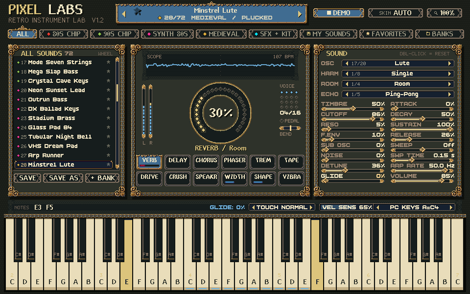
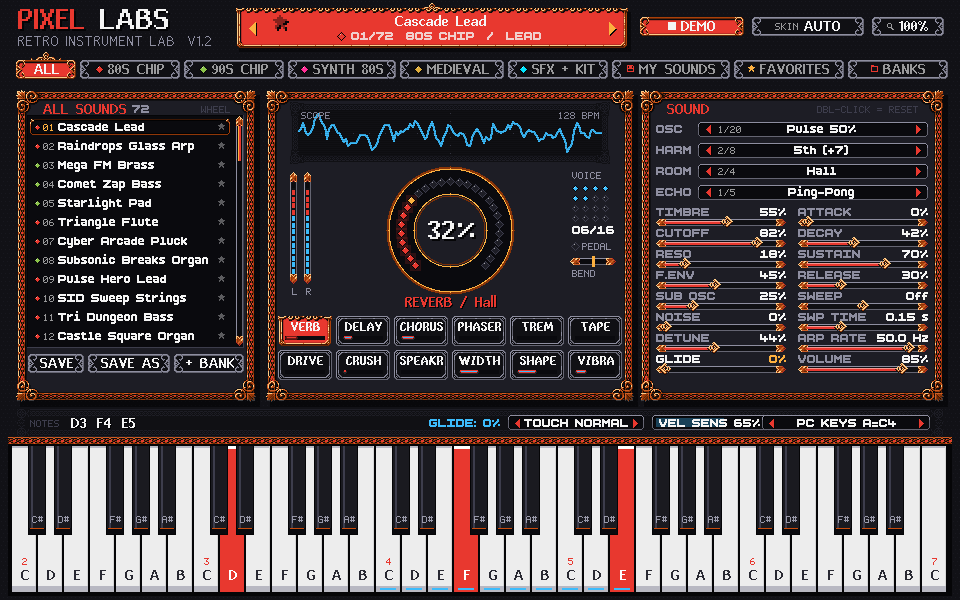
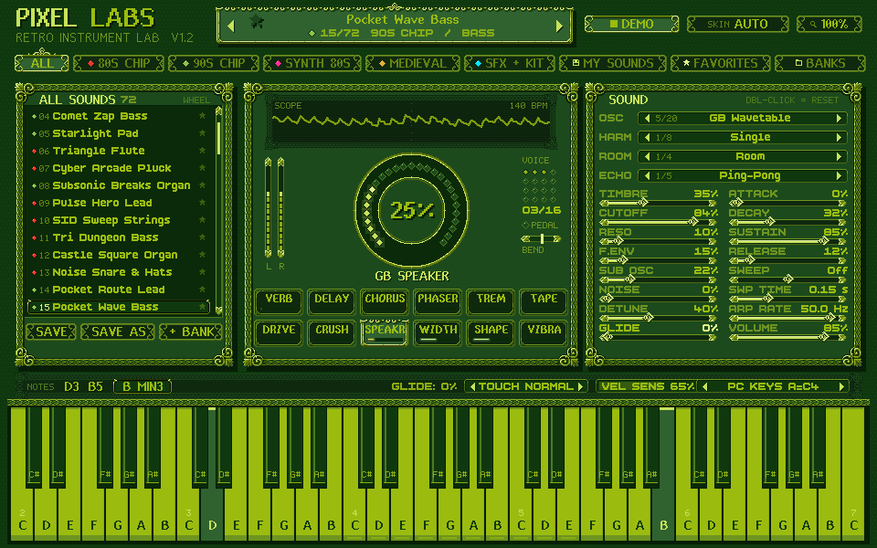
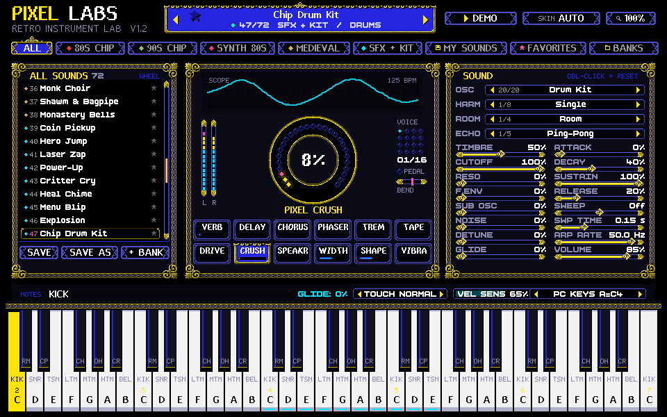
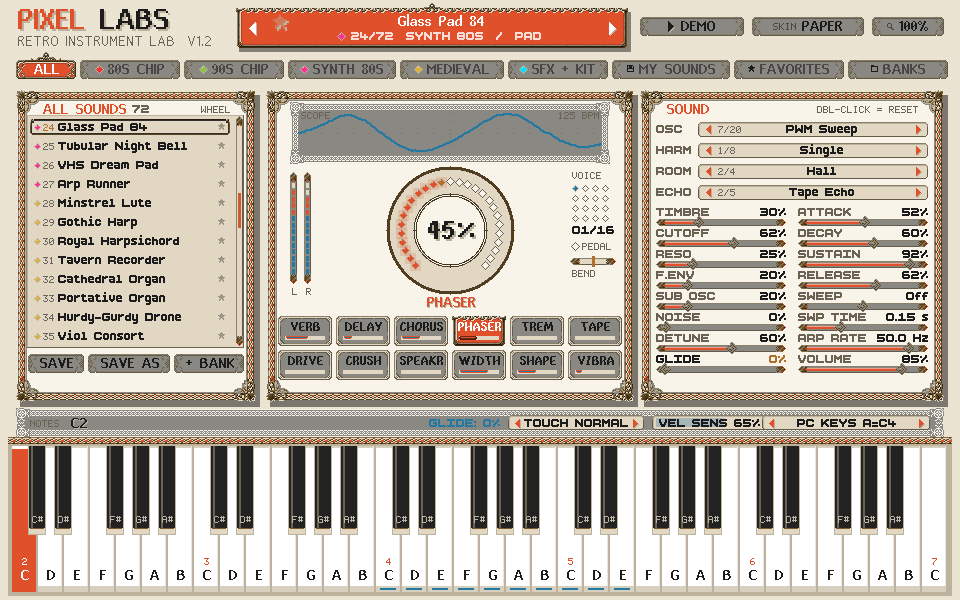
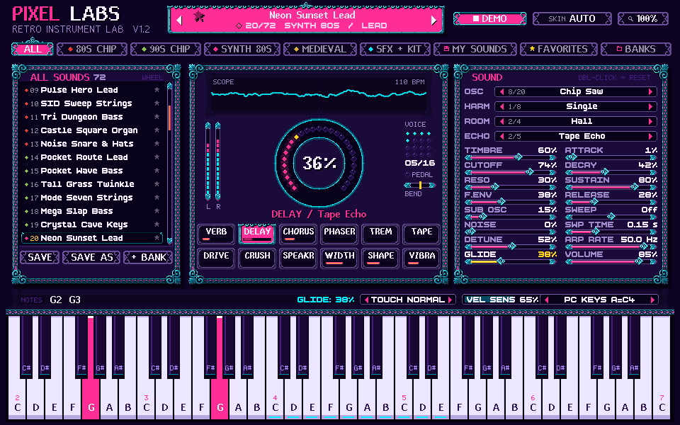
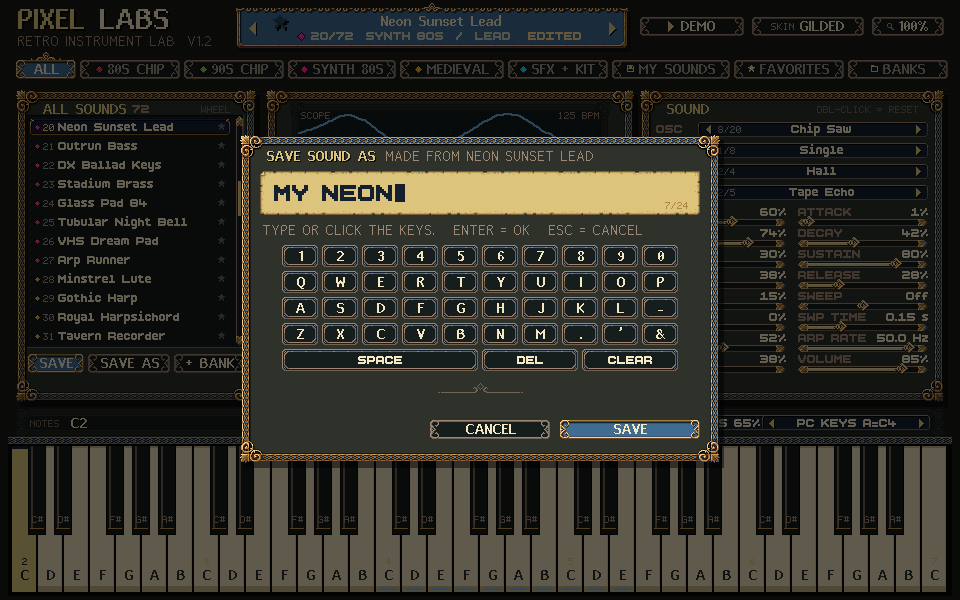
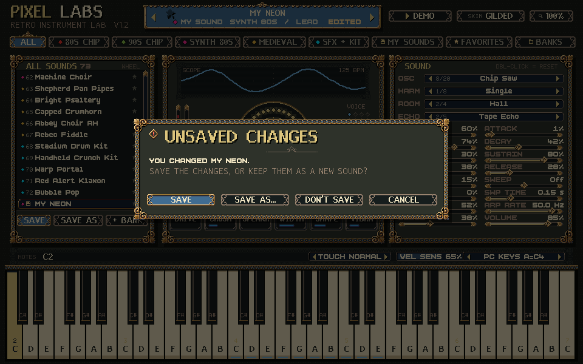
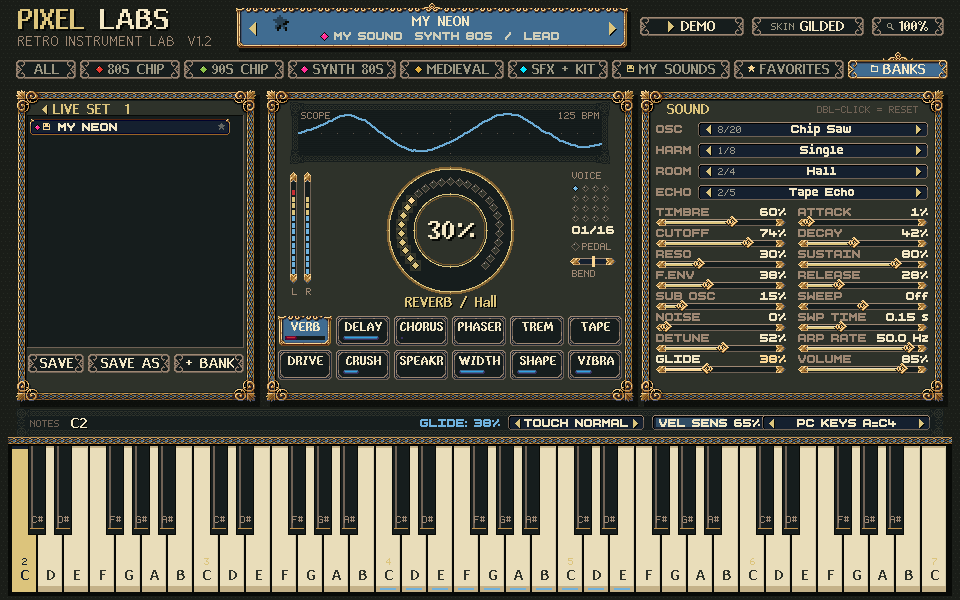

<p align="center">
  
</p>

<h1 align="center">Pixel LABS</h1>

<p align="center">
  A retro pixel-art synthesizer plugin (VST3 instrument) for Windows:<br>
  80s chip, 90s handheld, 80s synth, medieval instruments and game sound effects in one 16-voice engine.
</p>

<p align="center">
  
</p>

## Features

- **72 factory presets in five eras**
  - **80s chip:** pulse leads, NES-style triangle bass, noise percussion.
  - **90s chip:** handheld wavetable bass, 16-bit FM, "mode 7" strings.
  - **Synth 80s:** neon leads, FM ballad keys, brass, glass pads, VHS tape pads, arps.
  - **Medieval:** lute, gothic harp, harpsichord, recorder, cathedral and portative organs, hurdy-gurdy, viol consort, monk choir, shawm and bagpipe, bells.
  - **SFX + kit:** coin pickup, jump, laser, power-up, critter cry, heal chime, menu blip, explosion, warp portal, klaxon, bubble pop, and three 12-piece drum kits (one drum per note).
- **Your own sound library.** Save any edited sound under its own name, star favorites, and collect sounds into named banks. If you switch away from an edited sound, Pixel LABS asks whether to save it first.
- **Touch response.** Four velocity curves (Off, Light, Normal, Heavy) and a sensitivity amount. They belong to your keyboard, so changing sounds keeps them.
- **20 oscillator models.** Classic pulse, triangle, LFSR noise, PWM and wavetable are joined by 2-operator FM, a two-string plucked model (lute, harp), formant voices (choir, reed, bowed) and pitched drums.
- **12 effects on a macro dial.** Reverb has room, hall, church and cave types. Delay has ping-pong, tape, 16-bit, slapback and canyon types. Also chorus, phaser, tremolo, tape wow/flutter, drive, pixel crush, a handheld-speaker tone and stereo width.
- **Sound shaping:** full ADSR, filter envelope, pitch sweep, arpeggiator and harmony modes (fifths, octaves, organum, major/minor arps), glide, noise layer, detune and vibrato.
- **Playable 61-key keyboard.** Every key is labelled with its note name (C D E F G A B, C#…). Played keys light up, and the chord you're playing is named (e.g. `A MIN7`). You can play with the mouse or with your computer keyboard.
- **Pixel-art interface.** Gold knotwork windows, scroll-end buttons, jewel slider handles and gem LEDs from the *Dark Ages UI* pack, with four pixel fonts.
- **Seven skins plus AUTO:** GILDED (the default), NES, DMG, NEON, CODEX, ARCADE and PAPER. Each skin recolours the same art, and text colours adapt so every skin stays readable. AUTO picks the skin that matches the preset's era. Zoom goes from 100 to 200 %.
- **Four built-in demo songs**, chosen by era. Three are original; the medieval one is the traditional *Greensleeves*.
- **Host integration:** 37 automatable parameters, host tempo sync, a program-change preset list, and built-in MIDI CC mapping for common controllers.

| | | |
|:-:|:-:|:-:|
|  |  |  |
| 80s chip (NES) | 90s chip (DMG) | Medieval (GILDED) |
|  |  |  |
| SFX + drum kit (ARCADE) | PAPER | Synth 80s (NEON) |
|  |  |  |
| Save As | Unsaved changes | Banks |

## Install

Download from the [Releases](../../releases) page:

- **`PixelLABS-Setup-1.2.0.exe`** (recommended). Choose *Just for me* (no admin) or *All users*. It installs into the standard VST3 folder and adds an uninstall entry under *Settings → Apps*. Run it again to update or uninstall.
- **`PixelLABS-1.2.0-win64-vst3.zip`**: a portable copy. Copy the `PixelLABS.vst3` folder to `%LOCALAPPDATA%\Programs\Common\VST3` (just you) or `C:\Program Files\Common Files\VST3` (all users).

Then restart your DAW or re-scan plug-ins, and add **Pixel LABS** as an instrument. In REAPER: *Options → Preferences → Plug-ins → VST → Re-scan* (use *Clear cache/re-scan* if it doesn't show up).

You can update the plugin while your DAW is open: the installer moves the old file aside. Restart the DAW afterwards to load the new version.

Windows may show a SmartScreen warning because the installer isn't code-signed. Click *More info → Run anyway*.

### Silent install

| Command | What it does |
|---|---|
| `PixelLABS-Setup-1.2.0.exe /S` | install for the current user |
| `PixelLABS-Setup-1.2.0.exe /S /allusers` | install for all users (asks for admin) |
| `PixelLABS-Setup-1.2.0.exe /uninstall /S` | remove the per-user install (add `/allusers` for the machine-wide one) |
| `PixelLABS-Setup-1.2.0.exe /S /dir=D:\VST3` | copy the plugin into a custom VST3 folder |

Exit codes: `0` success, `1` error, `2` cancelled.

## Using it

| Area | How it works |
|---|---|
| Tabs | The era tabs filter the factory presets. `MY SOUNDS` lists the sounds you saved, `FAVORITES` the starred ones, and `BANKS` your banks. |
| Star | Click the star on a row, or next to the sound name, to add or remove a favorite. |
| SAVE AS / SAVE | Any edit, effects included, marks the sound `EDITED`. `SAVE AS` stores it under a new name in `MY SOUNDS`. `SAVE` overwrites a sound you saved before. Type the name on your computer keyboard or click the keys in the dialog. |
| + BANK | Adds the loaded sound to one or more banks. Make, rename and delete banks in the `BANKS` tab. A bank only points at sounds, so one sound can sit in several banks. |
| Preset bar | `◀` / `▶` step through the presets in the current tab. Scroll the mouse wheel over the list. |
| Macro dial | Pick an effect with the 12 buttons, then drag the dial up/down or use the mouse wheel. |
| Sound panel | The arrows choose oscillator, harmony, reverb room and echo type. Drag or scroll a slider to change it; double-click resets it to the loaded sound's value. |
| Keyboard | Click or drag across the keys; clicking lower on a key plays harder. With the plugin window focused, `A W S E D F T G Y H U J K O L P ;` play notes and `Z` / `X` shift the octave. |
| TOUCH / VEL SENS | Pick the velocity curve and how much velocity changes level and tone. Normal at 65 % is the classic response; Off plays every note at full level. |
| PLAY DEMO | Plays the built-in song for the current preset's era. |
| SKIN / ZOOM | Change the colour skin and window size. Both are saved with your project. |

### Your sound library

Saved sounds, favorites and banks are kept in `%APPDATA%\PixelLABS\PixelLABS_Library.txt`. Every Pixel LABS instance shares that file, so a sound saved on one track shows up on the others. Back up that file to keep your sounds, or copy it to another computer.

Projects store the whole sound as well, so a project opens with the right sound even on a computer without your library.

### MIDI CC mapping

| Control | Parameter |
|---|---|
| Pitch bend | ±2 semitones |
| CC1 (mod wheel) | Timbre |
| CC7 / CC11 | Volume (expression) |
| CC64 | Sustain pedal |
| CC5 | Glide |
| CC12–CC20 | Volume, Timbre, Cutoff, Resonance, Sub, Reverb, Chorus, Delay, Contour |
| CC22–CC29 | Reverb, Crush, Chorus, Delay, Contour, Vibrato, Cutoff, Resonance |
| CC71 / CC74 | Resonance / Cutoff |
| CC72 / CC73 / CC75 | Release / Attack / Decay |
| CC76 | Vibrato |
| CC91 / CC92 / CC93 / CC94 / CC95 | Reverb / Tremolo / Chorus / Delay / Phaser |

CC12–CC29 match the faders and knobs of an M-Audio Oxygen 61 (MK V) in preset mode.

## Build from source

You need Windows 10/11 x64 and Visual Studio 2022 or newer with the **Desktop development with C++** workload. No other SDKs or libraries are required: the VST3 interfaces the plugin uses are declared in `include/vst3/vst3_abi.h`.

### UI art

The interface art and fonts are free downloads, but they are not in this repository: the *Dark Ages UI* licence does not allow redistributing the pack. Download these and put them in `assets/` exactly as named:

| File | Download |
|---|---|
| `assets/UI/DarkAgesUi_v1.0.zip` | [Dark Ages UI](https://hypnobius.itch.io/dark-ages-ui) by Hypnobius |
| `assets/fonts/BoldPixels.ttf` | [BoldPixels](https://yukipixels.itch.io/boldpixels) by YukiPixels |
| `assets/fonts/Abaddon_Fonts_v1.2.zip` | [Abaddon](https://caffinate.itch.io/abaddon) by Caffinate (Nathan Scott) |
| `assets/fonts/Fibberish v1.0.zip` | [Fibberish](https://caffinate.itch.io/fibberish) by Caffinate (Nathan Scott) |

Leave the zips as downloaded. On the first build, `scripts/make_ui_assets.py` bakes them into `src/gui/UiAssets.inc` (also kept out of git). It needs Python 3 with Pillow and fontTools (`pip install pillow fonttools`). After changing an asset, delete `UiAssets.inc` or run the script again.

### Building

```bat
build.bat        :: plugin + installer + zip  ->  dist\
build.bat test   :: same, then run the automated host test
```

The host test (`tests/test_vst3_host.cpp`) loads the built plugin like a DAW would. It checks that every preset makes sound without NaNs, that project state round-trips (including state from pre-release builds), that the demo songs and on-screen keyboard work, and that saving, favorites and banks work through the editor's own buttons and dialogs. It writes WAV renders and UI screenshots to `build\test-output\`.

A `CMakeLists.txt` is included for IDEs (plugin and test only; the installer is built by `build.bat`). It bakes the UI art too. To regenerate the icon, run `python scripts/make_icon.py` (needs Pillow).

### Project layout

```text
src/dsp/        RetroSynthEngine: voices, oscillators, effects, demo sequencer
src/gui/        Win32 editor drawn into an offscreen pixel buffer: sprite 3/9-slice
                drawing, skin recolouring and pixel-font text (UiKit.h)
src/library/    Saved sounds, favorites and banks (the shared library file)
src/plugin/     VST3 component/controller, parameter IDs and names, factory entry
src/presets/    The 72 factory presets
include/vst3/   Minimal VST3 ABI declarations (no Steinberg SDK needed)
installer/      Self-contained setup.exe (plugin embedded as a resource)
tests/          Headless VST3 host test
scripts/        Icon and UI art generators
assets/         UI art and fonts (not in git; see "UI art")
docs/           README images
```

## License

[MIT](LICENSE). *Greensleeves* is a traditional melody in the public domain; the other demo songs and all presets are original to this project.

The MIT licence covers the code. The interface art and fonts belong to their authors and keep their own terms:

- *Dark Ages UI* by [Hypnobius](https://hypnobius.itch.io/): free for commercial and personal projects; the pack itself may not be redistributed, modified or not.
- *BoldPixels* by [YukiPixels](https://yukipixels.itch.io/boldpixels): [CC BY-SA 4.0](https://creativecommons.org/licenses/by-sa/4.0/).
- *Abaddon* and *Fibberish* by [Caffinate](https://caffinate.itch.io/) (Nathan Scott): free to use. The itch.io pages say CC0, the readmes say CC BY 3.0, and the Abaddon font files say CC BY-ND 3.0.

VST is a registered trademark of Steinberg Media Technologies GmbH.
